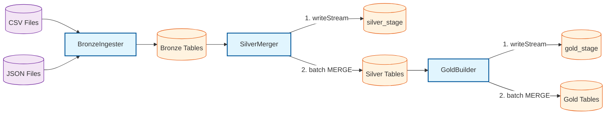
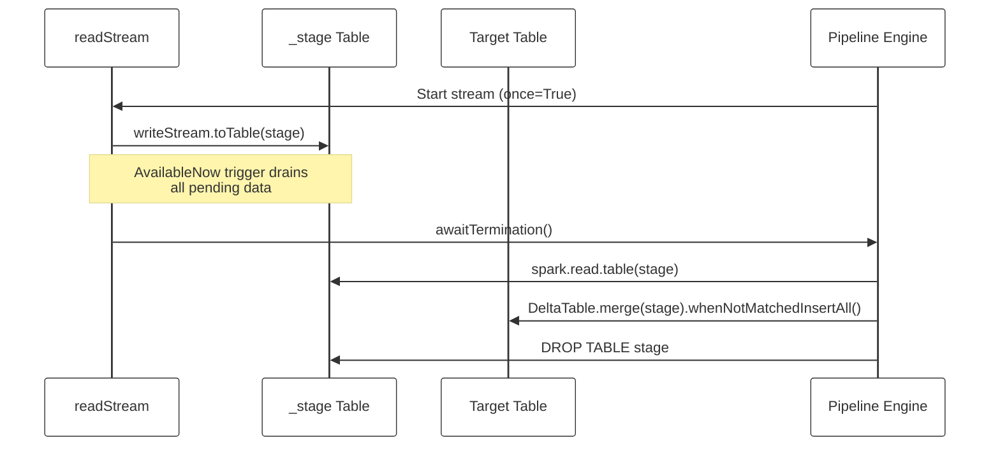

# Wearable Data Processor over DataLakehouse

An end-to-end streaming medallion pipeline (Bronze → Silver → Gold) that ingests IoT and application data from a fictional gym chain (user registrations, gym check-ins, and a Kafka event stream user profiles, workouts, heart-rate telemetry).

Built to run entirely on Databricks Free Edition through Databricks Connect (Python),and deliberately structured like a production repository to serve as a learning project on applying software engineering best practices to modern data engineering.

No paid Databricks account is required. Every design decision in this repo (path formats, checkpoint locations, schema handling) accounts for the constraints of the free tier instead of fighting them.

## What will you learn?

- Streaming structured data processing
- Real architecture, toy-sized data. The full medallion pattern (Auto Loader,CDC streaming, MERGE upserts, streaming aggregations) on a dataset small enough to reprocess in seconds.
- Production-shaped repository. Packaging (Python wheel), Asset Bundles,configuration with a documented priority chain, and tests. The engineering practices that tutorials usually skip.
- Every layer is observable. With Unity Catalog you can watch raw files become bronze tables, then curated silver entities, then gold aggregates. All fromCatalog Explorer.
- Documented failure modes. The compatibility playbookbelow records real errors hit while building this, so you learn why the rules exist, not just the rules.


## Architecture

The project implements a three-layer medallion architecture. Each layer has a specific contract and is orchestrated through declarative specs.



Due to Databricks' serverless compute limitations with `foreachBatch`, the project uses a stage-and-merge pattern for Silver and Gold layers. Streams write to an ephemeral `{name}_stage` Delta table, which is then batch-merged into the final target.



## Engineering highlights

- **Streaming vs Batch.** We chose Spark Structured Streaming because it provides a unified engine capable of handling both continuous streams and batch workloads with the same codebase, while offering built-in state management via automatic checkpoints and robust fault tolerance with automatic restarts upon failure. Traditional batch processing would force you to manually implement and manage processed file tracking, state management, and failure retries.
- **Specs vs. engines.** `SourceFeed` / `SilverSpec` dataclasses describe *what* flows; the engines define *how*. Custom `build_df` builders cover the irregular cases (stream–stream joins, aggregations).
- **One source of configuration truth.** A frozen `Config` dataclass declares each setting once (flag, env var, default); the CLI parser is generated from it. Resolution order: CLI > environment > `.env` > defaults.
- **MERGE safety policies.** Every target declares its update semantics: insert-only (immutable facts), last-writer-wins (`user_profile`), SCD Type 1 (`user_bins`), monotonic advance (`gym_logs`). All MERGEs are idempotent by business key, which is what makes replays and backfills safe.
- **Serverless-compatible streaming.** Silver/gold upserts use a stage + batch-MERGE pattern: `readStream` appends to an ephemeral `{name}_stage` Delta table via writeStream.toTable, and a batch `DeltaTable.merge()` promotes those rows into the target. This replaces `foreachBatch`, bypassing the `ISOLATION_STARTUP_FAILURE.SANDBOX_STARTUP` error on Databricks Serverless compute via Spark Connect. Public API, checkpoints, watermarks, dropDuplicates, and batch_transform semantics remain unchanged.
- **Explicit phase orchestration.** Dependent targets run in declared phases (`PHASES`); a phase fully drains before the next starts.
- **Two trigger modes.** Default `availableNow` (drain everything, exit — ideal on metered/free compute) or continuous `--stream --processing-time 30 seconds`. (Continuous mode is not supported on Serverless compute via Spark Connect as of now.)
- Partitioning strategy was implemented for the high-volume `kafka_multiplex_bz` table by enriching incoming records with `date_lookup` data, enabling efficient weekly partitioning to optimize query performance and data scanning for large-scale ingestion


## Prerequisites
- A Databricks Free Edition account
- Databricks Connect 18.0 to 18.3 (as per [Databricks requirements](https://docs.databricks.com/aws/en/dev-tools/databricks-connect/requirements#versions))
- Databricks CLI
- Python 3.12 (required for compatibility with Databricks Connect)
- An existing Databricks workspace and a Unity Catalogue catalogue with `USE CATALOG` and `CREATE SCHEMA` permissions.

## Configuration
Every setting follows the same priority chain — CLI beats environment, environment beats .env, .env beats defaults:

Aquí tienes la información organizada en una tabla Markdown:

| Flag | Env var | Default | Purpose |
| --- | --- | --- | --- |
| `--catalogue` | `WEARPIPE_CATALOGUE` | `None` | Databricks catalogue name (Unity Catalogue). Required: project does not creates UC catalogues |
| `--layer` | `WEARPIPE_LAYER` | bronze | Pipeline layer to run |
| `--base-checkpoint-path` | `WEARPIPE_BASE_CHECKPOINT_PATH` | chkpnt | Root volume path to persist checkpoints |
| `--volume` | `WEARPIPE_VOLUME` | wearpipe_vol | Databricks managed volume name |
| `--base-data-path` | `WEARPIPE_BASE_DATA_PATH` | raw | Root data path to store data |
| `--db-name` | `WEARPIPE_DB_NAME` | wearpipe_db | Databricks database name (schema) |
| `--max-files-per-trigger` | N/A | 1000 | Maximum number of files to process per trigger in Spark Structured Streaming to limit input flow to avoid OOM errors |
| `--stream` | N/A | False | Enable Spark Structured Streaming. Defaults to batch mode |
| `--processing-time` | `WEARPIPE_PROCESSING_TIME` | 15 | Trigger interval in seconds for continuous streaming mode |
| `--starting_version` | `WEARPIPE_STARTING_VERSION` | 0 | Delta version to start from; only honored when the stream checkpoint is empty. It enables deterministic cold-starts, backfills from version 0 using idempotent MERGE, partial bug replays from specific versions via DESCRIBE HISTORY, recovery after checkpoint corruption  |

## Setup and usage
1. Clone the repository and install dependencies:

```bash

git clone <repo-url> && cd <repo>
uv venv && source .venv/bin/activate      # or python -m venv .venv && source .venv/bin/activate
uv pip install -e ".[dev]"                # editable install incl. databricks-connect
```
2. Authenticate to Databricks:

```bash

databricks auth login --host https://<your-workspace>.databricks.com
````
3. Add `serverless_compute_id = auto` to your `~/.databrickscfg` file so the code remains valid for both prod and dev


4. Configure environment variables:
Copy .env.example to .env and adjust (DATABRICKS_CONFIG_PROFILE, GYM_ENV, etc.).
Keep .env out of version control — it is gitignored by default.


5. Run a pipeline:

```bash

# Run the Bronze layer
uv run wearpipe --catalogue dev --layer bronze

# Run the Silver layer
uv run wearpipe --catalogue dev --layer silver

# Run the Gold layer
uv run wearpipe --catalogue dev --layer gold

# Run all layers
uv run wearpipe --catalogue dev --layer all
```

6. Run the tests:

```bash

# Unit tests
uv run pytest tests/unit/

# Integration tests (requires Databricks connection)
uv run pytest tests/integration/test_end2end.py -s
```

## Project structure
```text
.
├── pyproject.toml
├── README.md
├── src/
│   └── wearpipe/
│       ├── __init__.py
│       ├── main.py           # CLI entry point and argparse configuration
│       ├── config.py         # Config dataclass and load_settings()
│       ├── history_loader.py # Load history and lookup data
│       ├── io.py             # build_object_path() helper for UC volume paths
│       ├── specs.py          # Spec dataclasses: MergeSpec, SilverSpec, GoldSpec
│       ├── ddl.py            # ddl_for_spec() helper for generating DDL from StructType
│       ├── transforms.py     # Column transformations (e.g., add_audit_columns)
│       ├── bronze.py         # BronzeIngester engine + SourceFeed dataclass + FEEDS list
│       ├── silver.py         # SilverMerger engine
│       ├── silver_specs.py   # SILVER_STREAMS dict
│       ├── gold.py           # GoldBuilder engine
│       ├── gold_specs.py     # GOLD_STREAMS dict + build_df functions
│       └── setup.py          # SetupHelper: creates DB, volume, and tables from specs
└── tests/
    ├── conftest.py           # Fixtures: spark, config
    ├── _helpers.py
    ├── unit/
    │   ├── test_ddl.py
    │   ├── test_config.py
    │   ├── test_transforms.py
    │   ├── test_gold_schema_check.py
    │   └── test_silver_schema_check.py
    └── integration/
        ├── test_history_loader.py
        ├── test_end2end.py   # Batch e2e test
        └── test_setup.py     # SetupHelper validation tests
```


## Engineering trade-offs & limitations

1. Serverless Compute Constraints
Databricks Serverless compute (used by default in Free Edition) restricts certain Spark Structured Streaming features.

- Continuous streaming triggers are disabled. The ProcessingTime trigger (continuous micro-batching) is not supported on Serverless compute via Spark Connect. The pipeline defaults to availableNow=True, which processes all pending data in a single finite micro-batch and exits. This is ideal for metered/free compute but precludes true continuous streaming tests.
- `foreachBatch` is unavailable. Serverless compute via Spark Connect lacks full compatibility with Python workers (e.g., ISOLATION_STARTUP_FAILURE.SANDBOX_STARTUP SQLSTATE: 39000). To bypass this, the pipeline uses the Stage + Batch-MERGE pattern: writeStream.toTable writes to an ephemeral _stage table, and a subsequent batch DeltaTable.merge() promotes rows to the final target.

2. Python and Databricks Connect Compatibility
The versions of Python and Databricks Connect are constrained by the Databricks Runtime (DBR) version of the Serverless compute. You cannot arbitrarily upgrade these dependencies.

Python 3.12: Required because the installed Databricks Connect SDK depends on features available in this version.
Databricks Connect v18.3.x: Pinned to match the DBR of the Serverless compute. See the official Databricks Connect compatibility matrix for details.

3. Schema Definition and Parser Quirks
When creating Delta tables via DDL or CTAS (CREATE TABLE AS SELECT), the Databricks SQL parser can silently drop or rename reserved keywords (e.g., time, update_type, sex) if they are not backtick-quoted.

Solution: The project uses a centralized ddl_for_spec() helper that reads the target_schema from each spec and generates backtick-quoted DDL. This is the single source of truth for physical table schemas.

## Next steps

Potential improvements for future iterations:

- Structured Logging: Replace print() statements with Python's logging module for configurable log levels and structured output.
- CI/CD Pipeline: Implement GitHub Actions to run ruff, mypy, and pytest on every push and pull request.
- Databricks Asset Bundles: Package the pipeline as an Asset Bundle for production deployment, replacing the manual Python CLI invocation.


